<div align="center">

# Sistema Inteligente de Mantenimiento Predictivo Industrial

**Anticipa qué componente de cada máquina va a fallar en las próximas 24 horas**
a partir de su telemetría, los errores del controlador y su historial de mantenimiento.

[](https://github.com/Spek7ro/ETL_Project_Industrial/actions/workflows/tests.yml)


[Características](#características) ·
[Resultados](#resultados) ·
[Arquitectura](#arquitectura) ·
[Inicio rápido](#inicio-rápido) ·
[API](#api-rest) ·
[Dashboard](#dashboard)

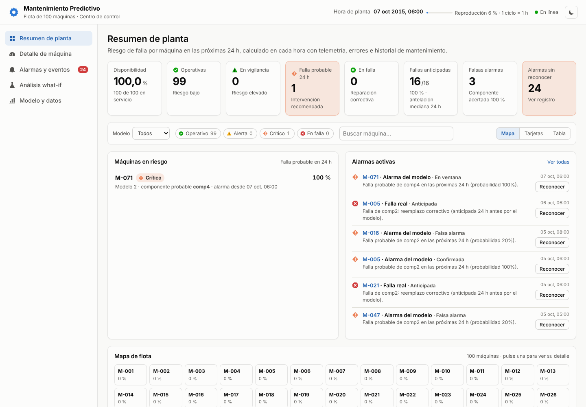

</div>

---

## Tabla de contenidos

1. [Descripción](#descripción)
2. [Características](#características)
3. [Resultados](#resultados)
4. [Arquitectura](#arquitectura)
5. [Datos](#datos)
6. [Pipeline ETL](#pipeline-etl)
7. [Ingeniería de características](#ingeniería-de-características)
8. [Modelo de machine learning](#modelo-de-machine-learning)
9. [API REST](#api-rest)
10. [Dashboard](#dashboard)
11. [Inicio rápido](#inicio-rápido)
12. [Estructura del proyecto](#estructura-del-proyecto)
13. [Configuración](#configuración)
14. [Pruebas e integración continua](#pruebas-e-integración-continua)
15. [Limitaciones y próximos pasos](#limitaciones-y-próximos-pasos)
16. [Créditos](#créditos)

---

## Descripción

Las paradas no planificadas son uno de los mayores costes de una planta industrial. Este
proyecto implementa un sistema de **mantenimiento predictivo** de extremo a extremo sobre el
dataset **Microsoft Azure Predictive Maintenance** (100 máquinas, un año de telemetría horaria):

- un **pipeline ETL** que descarga, valida, limpia y transforma los datos de sensores, errores y mantenimientos;
- un **modelo de machine learning** que estima, para cada máquina y cada hora, la probabilidad de que
  falle alguno de sus cuatro componentes en las próximas 24 h, y cuál;
- una **API REST** para predicción en tiempo real a partir de la historia reciente de una máquina;
- un **dashboard web** para operadores que reproduce hora a hora la telemetría real y mide en vivo
  si el modelo anticipa las fallas.

## Características

| | |
|---|---|
| 🔄 **ETL reproducible** | Ingesta con respaldo (Kaggle → réplica verificada), control de integridad, limpieza de las 5 tablas y reporte de calidad de datos. |
| 🧮 **Características temporales** | Estadísticos de sensores en ventanas de 3 h y 24 h, errores recientes y antigüedad de cada componente. Un único módulo las calcula para el entrenamiento y para la API. |
| 🤖 **Modelo multiclase calibrado** | Predice *qué* componente fallará. Probabilidades calibradas y umbral de alarma elegido por costes. |
| 🧪 **Evaluación honesta** | División temporal, sin fuga de información (verificado con una prueba) y métricas por evento: fallas anticipadas y antelación. |
| ⚡ **API en tiempo real** | FastAPI con validación estricta de entradas y registro de cada predicción en base de datos. |
| 📊 **Dashboard industrial** | Mapa de flota, riesgo por componente, tendencias de sensores, alarmas con su resultado, órdenes de trabajo y análisis what-if. Estilo HMI ISA-101, tema claro/oscuro y diseño adaptable a móvil. |
| 🐳 **Listo para desplegar** | Docker, docker-compose con PostgreSQL e integración continua con GitHub Actions. |

## Resultados

Evaluación sobre el periodo de **test (2 oct – 31 dic 2015)**, que el modelo no vio durante el entrenamiento:

| Métrica | Valor | Referencia (azar) |
|---|---:|---:|
| PR-AUC (falla en 24 h) | **0,997** | 0,018 |
| ROC-AUC | **1,000** | 0,500 |
| Precisión / Recall (por fila) | **96,7 % / 99,9 %** | — |
| Fallas anticipadas (por evento) | **163 de 163** | — |
| Antelación mediana de la alarma | **24 h** | — |
| Componente acertado en la alarma | **100 %** | 25 % |

| Componente | Precisión | Recall |
|---|---:|---:|
| comp1 | 91,6 % | 96,5 % |
| comp2 | 95,7 % | 98,7 % |
| comp3 | 92,9 % | 96,6 % |
| comp4 | 96,2 % | 97,8 % |

> [!IMPORTANT]
> **El dataset es sintético.** Microsoft lo generó para un tutorial: cada falla va precedida de
> errores del controlador y de la desviación de un sensor concreto, por lo que las métricas son
> casi perfectas. Con telemetría real de planta se esperan valores más modestos. La metodología
> (división temporal, comprobación de fuga de información, evaluación por evento) es la misma.

## Arquitectura

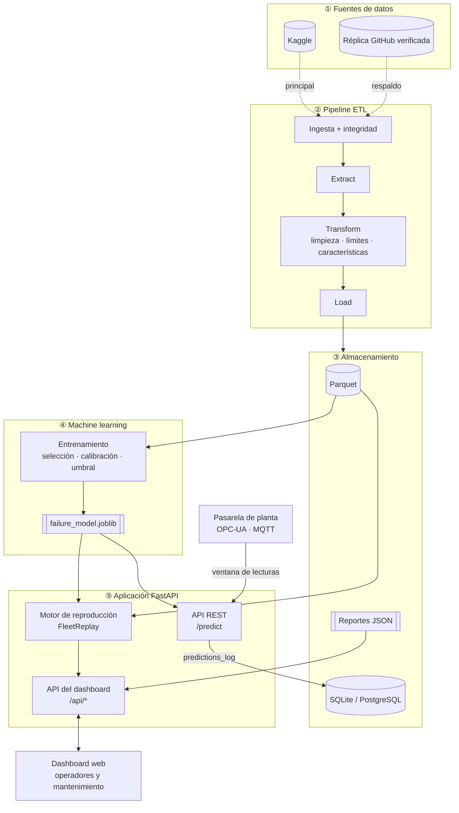

El mismo módulo de características (`src/models/features.py`) se usa en tres sitios: el ETL (en
bloque, para todo el histórico), la API (una ventana por máquina) y el motor de reproducción (toda
la flota, hora a hora). Así se garantiza que el modelo recibe en producción exactamente las mismas
variables con las que se entrenó.

## Datos

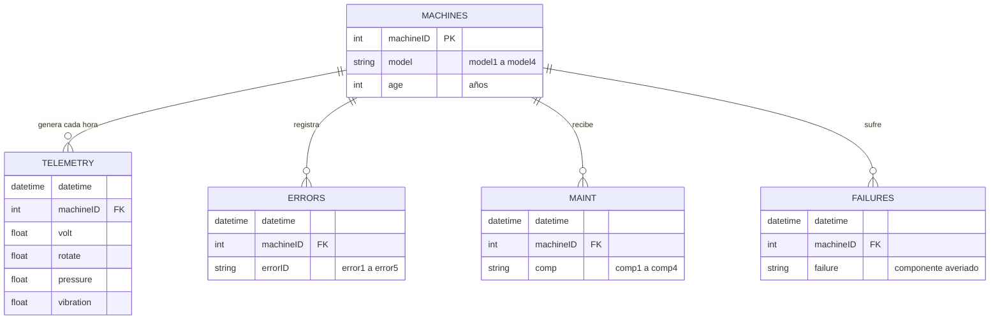

| Tabla | Filas | Contenido |
|---|---:|---|
| `PdM_telemetry` | 876.100 | Voltaje, rotación, presión y vibración por máquina y hora (año 2015) |
| `PdM_errors` | 3.919 | Errores del controlador (`error1` … `error5`) |
| `PdM_maint` | 3.286 | Reemplazos de componentes, programados o por avería |
| `PdM_failures` | 761 | Fallas: componente reemplazado por avería |
| `PdM_machines` | 100 | Modelo (`model1` … `model4`) y antigüedad |

La ingesta intenta primero Kaggle (`arnabbiswas1/microsoft-azure-predictive-maintenance`) y, si no
hay acceso, una réplica pública en GitHub. Esa réplica se contrastó con la copia publicada por
Microsoft (`microsoft/AMLWorkshop`): telemetría, fallas y errores coinciden al 100 %. Tras cada
descarga se verifica el número de filas de cada archivo. Los CSV (~80 MB) no se versionan.

## Pipeline ETL

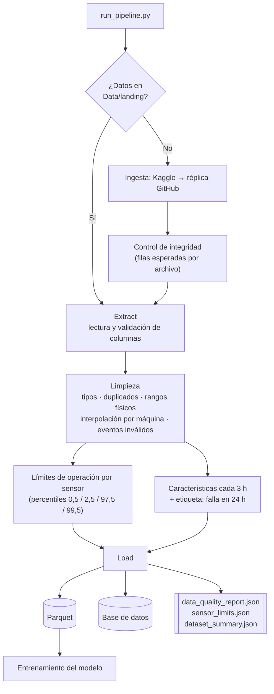

| Etapa | Responsabilidad |
|---|---|
| **Ingesta** (`ingest_data.py`) | Descarga con respaldo y verificación de integridad. |
| **Extract** (`extract.py`) | Lee las 5 tablas y valida que tengan las columnas requeridas. |
| **Transform** (`transform.py`) | Normaliza tipos y fechas; elimina duplicados; las lecturas fuera de rango físico se anulan y se interpolan dentro de cada máquina; descarta eventos con componente, error o máquina desconocidos; calcula límites de operación, características y etiquetas. |
| **Load** (`load.py`) | Escribe Parquet, reportes JSON y las tablas limpias en la base de datos (`DATABASE_URL`). |

## Ingeniería de características

Para cada máquina y cada instante *t*, el sistema resume su historia reciente:

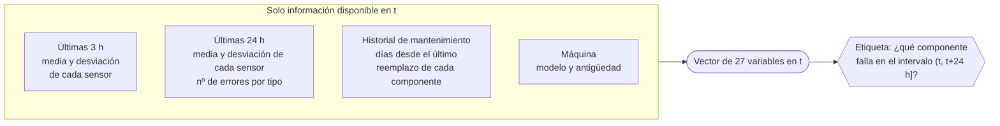

| Grupo | Variables |
|---|---|
| Sensores | `{volt, rotate, pressure, vibration}` × `{media, desviación}` × `{3 h, 24 h}` → 16 |
| Errores | número de `error1` … `error5` en las últimas 24 h → 5 |
| Componentes | días desde el último reemplazo de `comp1` … `comp4` → 4 |
| Máquina | antigüedad y modelo (codificado *one-hot*) → 2 |

Cada componente tiene un **sensor delator**. Esta es la desviación media de 24 h antes de su falla
respecto a la operación normal, en desviaciones estándar:

| | Voltaje | Rotación | Presión | Vibración |
|---|---:|---:|---:|---:|
| **comp1** | **+4,5 σ** | −0,1 σ | 0,0 σ | 0,0 σ |
| **comp2** | +0,1 σ | **−4,7 σ** | +0,1 σ | +0,1 σ |
| **comp3** | +0,1 σ | −0,2 σ | **+5,5 σ** | 0,0 σ |
| **comp4** | 0,0 σ | −0,2 σ | +0,1 σ | **+5,2 σ** |

> [!NOTE]
> Una prueba automática recalcula las características de filas al azar usando **solo** datos
> anteriores o iguales a su instante y comprueba que coinciden exactamente con las almacenadas.
> Ninguna variable puede contener información del futuro.

## Modelo de machine learning

### División temporal

Los datos se dividen **por fecha**, nunca al azar, con un hueco de 24 h entre tramos para que las
etiquetas de un tramo no vean el siguiente:

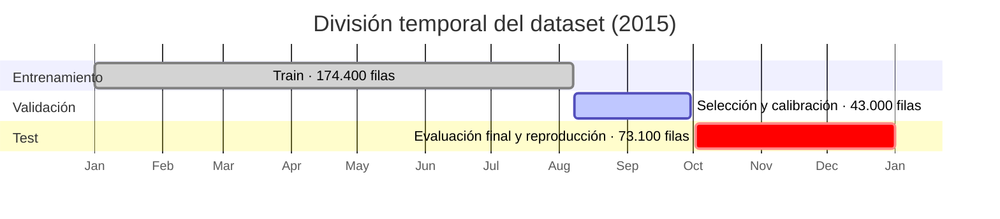

### Flujo de entrenamiento

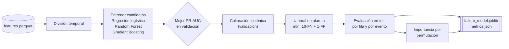

| Decisión | Motivo |
|---|---|
| **Clasificación multiclase** (`none`, `comp1` … `comp4`) | El operador necesita saber *qué* reemplazar, no solo que algo va a fallar. |
| **Selección por PR-AUC** | Las fallas son solo el 2 % de las filas; la exactitud o el ROC-AUC engañan con clases tan desbalanceadas. |
| **Calibración isotónica** | El dashboard muestra porcentajes: un 80 % debe significar realmente un 80 %. |
| **Umbral por costes** | Una falla no anticipada (parada de línea) cuesta mucho más que una inspección innecesaria. La relación 10:1 se configura con `COST_MISSED_FAILURE` y `COST_FALSE_ALARM`. |
| **Métricas por evento** | Lo que importa en planta es cuántas fallas se anticipan y con cuánta antelación. |

Modelos comparados (PR-AUC en validación): Random Forest **0,999**, Gradient Boosting 0,998,
regresión logística 0,974. Las variables más influyentes son los errores del controlador
(`error5`, `error1`, `error4`) y la media de 24 h del voltaje.

## API REST

Documentación interactiva (Swagger) en `http://localhost:8000/docs`.

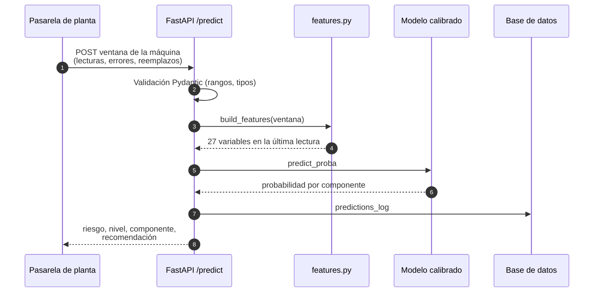

| Método | Ruta | Descripción |
|---|---|---|
| `GET` | `/health` | Estado del servicio y del modelo |
| `GET` | `/model/info` | Modelo, horizonte, umbrales y métricas de test |
| `POST` | `/predict` | Riesgo de falla de una máquina a partir de su historia reciente |
| `POST` | `/predict/batch` | Ídem para hasta 200 máquinas |

<details>
<summary><b>Ejemplo real: la máquina M-084, 12 h antes de una falla de comp1</b></summary>

[`docs/examples/predict_request.json`](docs/examples/predict_request.json) contiene la ventana que
enviaría una pasarela de planta: las 24 lecturas horarias de M-084 hasta el 1 de octubre de 2015 a
las 18:00, el error registrado en ese periodo y el último reemplazo de cada componente.

```bash
curl -X POST http://localhost:8000/predict \
  -H "Content-Type: application/json" \
  -d @docs/examples/predict_request.json
```

```json
{
  "machine_id": "M-084",
  "timestamp": "2015-10-01T18:00:00",
  "failure_probability": 0.9785,
  "failure_predicted": true,
  "risk_level": "ALTO",
  "predicted_component": "comp1",
  "component_probabilities": {"comp1": 0.9785, "comp2": 0.0, "comp3": 0.0, "comp4": 0.0},
  "horizon_hours": 24,
  "recommendation": "Falla probable de comp1 en las próximas 24 h: programar su reemplazo antes del próximo turno."
}
```

En el dataset, comp1 de M-084 falló el 2 de octubre a las 06:00, 12 h después de esta predicción.
Para obtener la mejor precisión, envíe las últimas 24 lecturas horarias, los errores de las últimas
24 h y el último reemplazo de cada componente.

</details>

## Dashboard

Al iniciar la API, `http://localhost:8000/` abre el dashboard. No requiere compilación ni conexión
a internet (Chart.js se sirve desde `frontend/vendor/`).

<table>
  <tr>
    <td width="50%">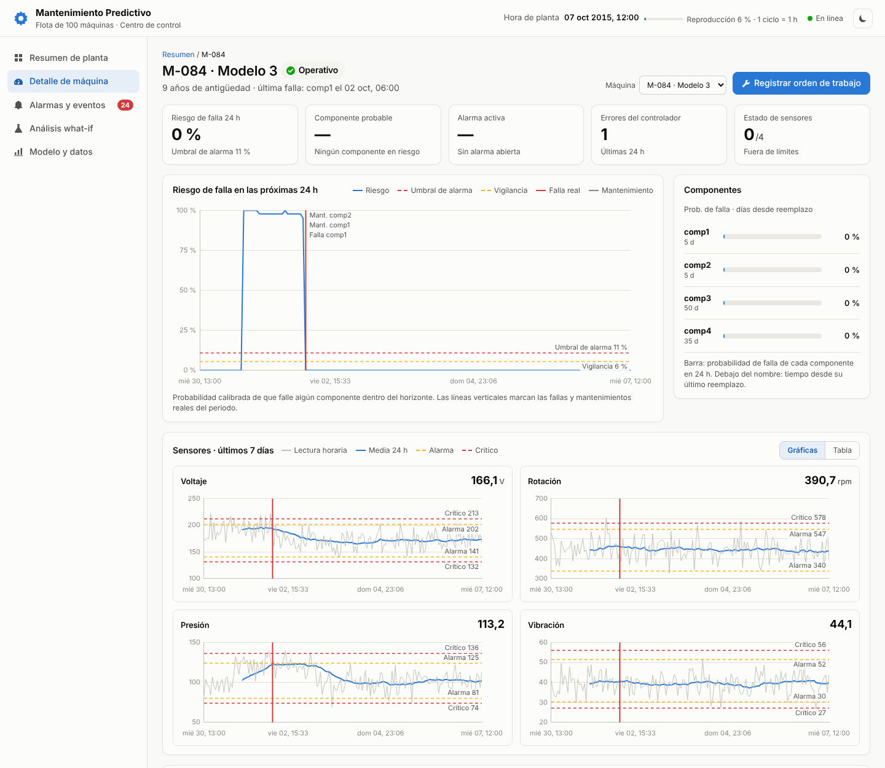</td>
    <td width="50%">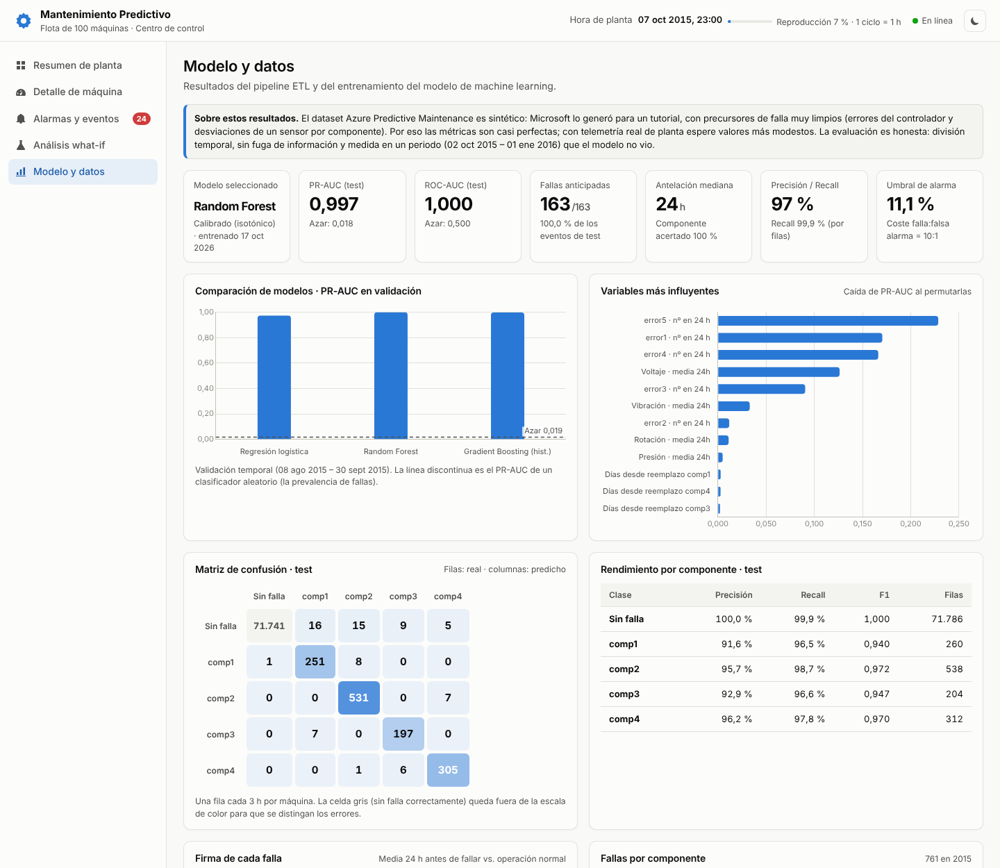</td>
  </tr>
  <tr>
    <td align="center"><sub><b>Detalle de máquina:</b> el riesgo sube 24 h antes de la falla real de comp1, a la vez que la media de 24 h del voltaje.</sub></td>
    <td align="center"><sub><b>Modelo y datos:</b> comparación de modelos, variables influyentes y firma de cada falla.</sub></td>
  </tr>
  <tr>
    <td width="50%">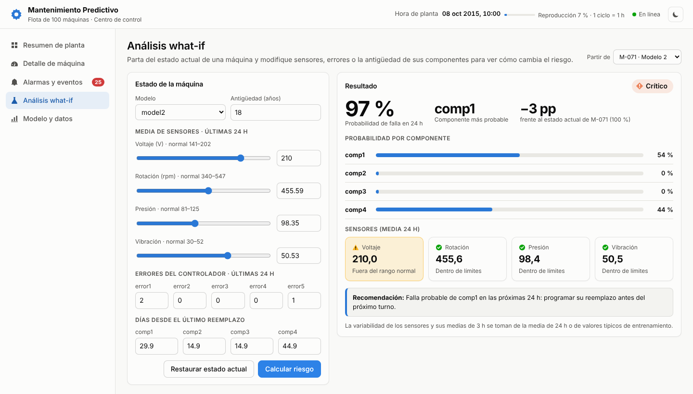</td>
    <td width="50%">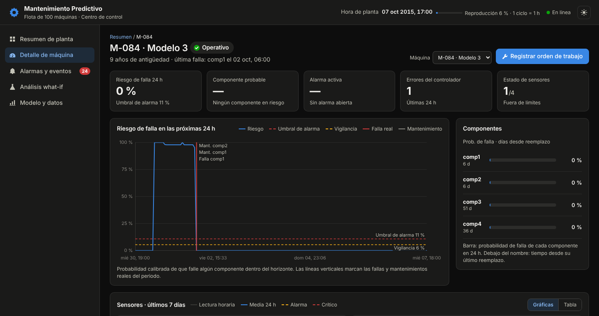</td>
  </tr>
  <tr>
    <td align="center"><sub><b>Análisis what-if</b> sobre el estado actual de una máquina.</sub></td>
    <td align="center"><sub><b>Tema oscuro</b> para salas de control.</sub></td>
  </tr>
</table>

| Vista | Para qué sirve |
|---|---|
| **Resumen de planta** | KPIs de la flota, mapa de las 100 máquinas (o tarjetas o tabla), máquinas en riesgo y alarmas activas, con filtros por modelo, estado y búsqueda. |
| **Detalle de máquina** | Evolución del riesgo con umbrales y marcas de fallas y mantenimientos reales; probabilidad por componente; 7 días de sensores (lectura horaria y media de 24 h) frente a sus límites; registro de órdenes de trabajo. |
| **Alarmas y eventos** | Alarmas del modelo con su resultado, fallas reales (anticipadas o no), mantenimientos, errores y órdenes de trabajo; reconocimiento individual o masivo. |
| **Análisis what-if** | Parte del estado actual de una máquina y permite cambiar sensores, errores y antigüedad de componentes para ver cómo cambia el riesgo. |
| **Modelo y datos** | Métricas, comparación de modelos, importancia de variables, matriz de confusión, rendimiento por componente, firma de fallas y calidad del ETL. |

### Reproducción en tiempo real

El dashboard no usa datos inventados: **reproduce hora a hora la telemetría real del periodo de
test** (por defecto, una hora de planta cada 3 segundos). Como las fallas reales son conocidas,
mide en vivo el desempeño del modelo.

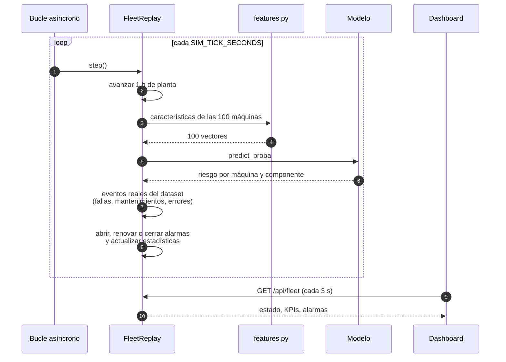

### Estados de una máquina

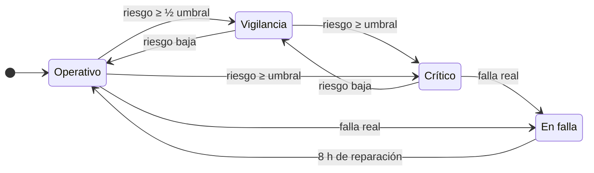

### Ciclo de vida de una alarma

Una alarma permanece abierta mientras el riesgo siga sobre el umbral y se evalúa contra lo que
realmente ocurrió:

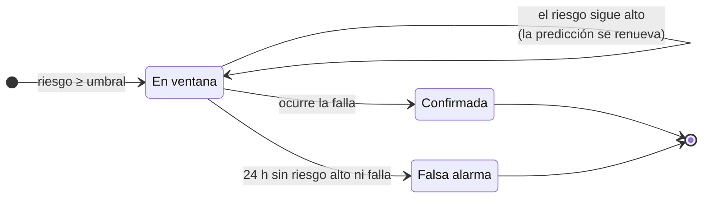

Siguiendo la filosofía HMI de **ISA-101**, el color se reserva para estados anómalos y siempre va
acompañado de icono y texto, de modo que la información nunca depende solo del color.

## Inicio rápido

### Requisitos

- Python 3.10 o superior
- Unos 250 MB libres (dataset, datos procesados, base de datos y modelo)

### Instalación local

```bash
git clone https://github.com/Spek7ro/ETL_Project_Industrial.git
cd ETL_Project_Industrial

python -m venv .venv
source .venv/bin/activate              # Windows: .venv\Scripts\Activate.ps1
pip install -r requirements-dev.txt

python run_pipeline.py                 # descarga (~80 MB, solo la 1.ª vez), ETL y entrenamiento (~2 min)
uvicorn src.api.main:app --reload      # dashboard: http://localhost:8000 · API: http://localhost:8000/docs
```

Cada etapa también puede ejecutarse por separado:

```bash
python -m src.etl.ingest_data          # solo descarga (use --force para repetirla)
python -m src.etl.pipeline             # solo ETL
python -m src.models.train             # solo entrenamiento
```

### Docker

```bash
docker compose up --build              # API + dashboard en :8000 y PostgreSQL en :5432
```

## Estructura del proyecto

```
ETL_Project_Industrial/
├── Data/
│   ├── landing/                 # Datos crudos descargados (no se versionan)
│   └── processed/               # Parquet y reportes generados por el ETL
├── docs/
│   ├── images/                  # Capturas del dashboard
│   └── examples/                # Petición y respuesta reales de /predict
├── frontend/                    # Dashboard: HTML, CSS, JS y Chart.js local
│   ├── css/styles.css
│   ├── js/{app,charts,format}.js
│   └── index.html
├── models/                      # Modelo entrenado y métricas (generados)
├── src/
│   ├── config.py                # Configuración central
│   ├── etl/                     # ingest_data · extract · transform · load · pipeline
│   ├── models/                  # features · train · predict
│   ├── monitoring/replay.py     # Reproducción en tiempo real de la flota
│   └── api/                     # main · dashboard · schemas
├── tests/                       # 34 pruebas con datos sintéticos
├── .github/workflows/tests.yml  # Integración continua
├── Dockerfile · docker-compose.yml
├── run_pipeline.py              # Ingesta + ETL + entrenamiento
└── requirements.txt · requirements-dev.txt
```

## Configuración

Todas las opciones se pueden definir en un archivo `.env` (ver `.env.example`):

| Variable | Por defecto | Descripción |
|---|---|---|
| `DATABASE_URL` | `sqlite:///Data/warehouse.db` | Base de datos del ETL y del registro de predicciones |
| `HORIZON_HOURS` | `24` | Horizonte de predicción |
| `COST_MISSED_FAILURE` | `10` | Coste relativo de una falla no anticipada |
| `COST_FALSE_ALARM` | `1` | Coste relativo de una falsa alarma |
| `LOG_PREDICTIONS` | `true` | Registrar cada predicción de la API |
| `SIMULATION_ENABLED` | `true` | Activar la reproducción de la flota |
| `SIM_TICK_SECONDS` | `3` | Segundos reales entre ciclos de reproducción |
| `REPLAY_HOURS_PER_TICK` | `1` | Horas de planta por ciclo |
| `DATA_DIR`, `MODELS_DIR` | `Data/`, `models/` | Directorios de datos y modelos |

## Pruebas e integración continua

```bash
python -m pytest
```

Las 34 pruebas usan un **generador de datos sintéticos con el mismo formato** que el dataset
(con precursores de falla conocidos), así que se ejecutan en ~1 minuto sin descargar nada.

| Archivo | Qué verifica |
|---|---|
| `test_etl.py` | Validación de esquema, limpieza de datos sucios, cálculo de características y etiquetas, **ausencia de fuga de información**, límites de sensores y carga. |
| `test_model.py` | Que el modelo aprende la señal, orden cronológico de la división y **coherencia entre la predicción en tiempo real y la del entrenamiento**. |
| `test_replay.py` | Inicio en el periodo de test, anticipación de fallas, ciclo de vida de alarmas, órdenes de trabajo y reinicio de la reproducción. |
| `test_api.py` | Endpoints, validación de entradas inválidas (422), what-if, analítica y funcionamiento sin modelo (503). |

GitHub Actions ejecuta las pruebas y el pipeline completo (descarga, ETL y entrenamiento) en cada
*push* y *pull request*.

## Limitaciones y próximos pasos

- **Datos sintéticos.** Validar el sistema con telemetría real de planta antes de usarlo en producción.
- **Horizonte fijo de 24 h.** El modelo indica si la falla ocurrirá en las próximas 24 h. Varios
  horizontes (24/48/72 h) o un modelo de supervivencia permitirían estimar el tiempo restante con más detalle.
- **Conexión a planta.** La reproducción lee el histórico; para producción basta con alimentar
  `FleetReplay._process_hour` desde la fuente real (OPC-UA, MQTT o un historiador).
- **Explicabilidad por predicción.** Añadir SHAP para mostrar al técnico qué variables provocaron cada alarma.
- **Reentrenamiento continuo.** Unir `predictions_log` con las fallas registradas para reentrenar y vigilar la deriva de los datos.

## Créditos

- Dataset: *Microsoft Azure Predictive Maintenance*, publicado por Microsoft como ejemplo para
  Azure AI Gallery y redistribuido en Kaggle por
  [arnabbiswas1](https://www.kaggle.com/datasets/arnabbiswas1/microsoft-azure-predictive-maintenance).
- Gráficas: [Chart.js](https://www.chartjs.org/) (licencia MIT).
